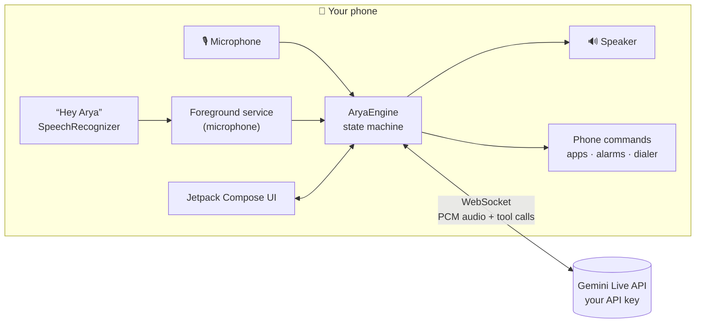

<!-- Replace OWNER/REPO below with your GitHub path once, e.g.:  sed -i 's#OWNER/REPO#yourname/arya#g' README.md -->

<div align="center">


<br>

# Arya

**An open-source voice AI companion for Android.**
Native Kotlin and Jetpack Compose, talking to Gemini Live straight from your phone.

<br>

[](https://github.com/OWNER/REPO/actions/workflows/android.yml)
[](https://github.com/OWNER/REPO/releases)
[](LICENSE)
[](https://github.com/OWNER/REPO/stargazers)


[Features](#-features) ·
[Quick start](#-quick-start) ·
[Using Arya](#-using-arya) ·
[Architecture](#-architecture) ·
[Privacy](#-privacy--security) ·
[Contributing](#-contributing)

</div>

---

> [!WARNING]
> **Early software.** This native version has been written and reviewed but **never compiled or run on a device** by its
> author: the first CI build will probably need small fixes, and the wake word, audio echo handling and foreground service
> need testing on real phones. Please open an issue with your device and Android version if something misbehaves.

## ✨ Features

| | |
| --- | --- |
| 🎙️ **Real-time voice** | Talk naturally in Hindi, English or Hinglish. Interrupt Arya mid-sentence, like a phone call. |
| ⌨️ **Type or talk** | Typed messages are answered out loud too. Long-press any reply to copy or report it. |
| 👋 **"Hey Arya"** | Optional wake word: off, only while the app is open, or always (a visible notification stays while she listens). |
| 📱 **Phone commands** | Opens apps, sets alarms and timers, opens the dialer, searches the web, flashlight, volume. Calls only open the dialer. |
| 🧠 **Local memory** | Ask her to remember things. Memories live on your phone and you can delete any of them. |
| 🎨 **A living interface** | Animated aurora background, voice-reactive equalizer, themes that glide when Arya (or you) change them. |
| 🔒 **Private by design** | Your own Gemini key, encrypted with the Android Keystore. No Arya server, no ads, no analytics. |
| 🧩 **Play-ready** | Prominent disclosures, in-app report flow, no restricted permissions. See [docs/PLAY_STORE.md](docs/PLAY_STORE.md). |

## 📸 Screenshots

Screenshots will be added after the first build on real devices. Drop PNGs into `docs/screenshots/` and reference them here.

## 🚀 Quick start

1. **Get a Gemini API key** (free): <https://aistudio.google.com/apikey>
2. **Install Arya**
   - From GitHub: open **Actions → Build Arya**, download `Arya-debug-apk` from the latest run, and install it
     (allow "install unknown apps" for your browser or file manager), **or**
   - build it yourself, see below.
3. Open Arya, paste the key, tap the microphone, and say hello.

## 🛠️ Build from source

**Requirements:** JDK 17, Android SDK 36 (Android Studio recommended), Gradle 8.14+.

```bash
git clone https://github.com/OWNER/REPO.git && cd REPO
gradle wrapper --gradle-version 8.14.3     # once, no wrapper is committed
./gradlew :app:assembleDebug               # → app/build/outputs/apk/debug/app-debug.apk
```

Or open the folder in Android Studio and press **Run**.

<details>
<summary><b>Build on GitHub Actions (no local setup)</b></summary>

Push to `main`: **Actions → Build Arya** produces a debug APK artifact on every run.

For a signed release (APK + AAB for Google Play) add these repository secrets and push a tag such as `v0.2.0`:

| Secret | Meaning |
| --- | --- |
| `ARYA_KEYSTORE_BASE64` | your upload keystore, base64-encoded |
| `ARYA_KEYSTORE_PASSWORD` | keystore password |
| `ARYA_KEY_ALIAS` | key alias |
| `ARYA_KEY_PASSWORD` | key password |

</details>

<details>
<summary><b>Configuration</b></summary>

`gradle.properties` holds three optional values: `aryaReportEmail`, `aryaReportUrl` (where in-app reports go) and `aryaPrivacyUrl`.
In the app, **Settings** controls voice, theme, name, wake word, contacts access and (under *Advanced*) the API key and Live model id
(default `gemini-3.1-flash-live-preview`).

</details>

## 🎙️ Using Arya

Tap the microphone and talk. A few things to try:

| Say | What happens |
| --- | --- |
| "Open WhatsApp" / "YouTube kholo" | Opens the app |
| "Set an alarm for 6:30" | Sets it in your clock app |
| "Timer for 10 minutes" | Starts a timer |
| "Call Mom" | Looks up the contact and opens the dialer (you press call) |
| "Search the weather in Delhi" | Opens a web search |
| "Turn on the flashlight" · "Volume 40" | Flashlight and media volume |
| "Change the theme to emerald" | The whole UI changes colour |
| "Remember that I like green tea" | Saved to local memory |

When the app is closed, Android does not let apps launch other apps, so Arya posts a **"tap to…"** notification instead.
A conversation ends after 90 seconds of silence to release the microphone.

## 🏗️ Architecture



<details>
<summary><b>Project structure</b></summary>

```
app/src/main/java/com/arya/companion/
├── live/
│   ├── AryaEngine.kt        conversation state machine, mic gate, barge-in, tools, idle timeout
│   ├── LiveClient.kt        OkHttp WebSocket to BidiGenerateContent
│   ├── Audio.kt             AudioRecord / AudioTrack, echo cancellation, speaker and headset routing
│   ├── Persona.kt           Arya's system instruction
│   └── Tools.kt             function declarations and runner
├── device/DeviceActions.kt  phone commands through standard Android intents
├── service/
│   ├── AryaVoiceService.kt  foreground service hosting a conversation and the wake word
│   └── WakeWordListener.kt  "Hey Arya" on Android's SpeechRecognizer
├── data/                    settings (API key in the Keystore) and memories
└── ui/                      theme, components, screens, dialogs
```

</details>

## 🔐 Privacy & security

- **Your key, your phone.** The Gemini API key is stored encrypted with the Android Keystore and sent only to Google.
- **Audio** goes to Gemini only while a conversation is active. With the wake word on, Android's speech recognizer listens for the name
  first (on-device with an offline pack on Android 13+, otherwise Google's speech service). Nothing reaches Gemini before "Hey Arya".
- **No server, no ads, no analytics, no tracking.** Memories stay on the phone; `allowBackup` is off.
- **Permissions are minimal**: microphone, notifications, foreground service, alarm, optional contacts. No overlay, no call or SMS, no all-apps query.

Full text: [PRIVACY.md](PRIVACY.md).

## 📱 Compatibility

| | |
| --- | --- |
| Minimum | Android 11 (API 30) |
| Target / compile | Android 16 (API 36), the level Google Play requires from 31 Aug 2026 |
| Devices tested | none yet |
| Known quirks | some phones beep when the wake-word recognizer restarts; aggressive battery savers may stop the background service |

## 🗺️ Roadmap

- [ ] First verified build and device testing (Android 11, 13, 14, 16)
- [ ] Dedicated wake-word engine (Porcupine or openWakeWord) instead of speech-to-text matching
- [ ] Optional animated character (video loops or Live2D) with lip-sync
- [ ] Localised UI (Hindi first)
- [ ] Home-screen widget and quick-settings tile
- [ ] Unit tests for the engine and tool runner

## 🤝 Contributing

Issues and pull requests are welcome, see [CONTRIBUTING.md](CONTRIBUTING.md). Bug reports are most useful with the phone model,
Android version and what you said or tapped just before it happened.

## ❓ FAQ

<details>
<summary><b>Does it cost anything?</b></summary>
Arya is free. Gemini has a free tier for API keys; usage beyond it is billed by Google to your own account.
</details>

<details>
<summary><b>Why does Arya say she opened a notification instead of the app?</b></summary>
Android blocks apps from launching other apps while they are in the background. Tap the notification to finish the action.
</details>

<details>
<summary><b>Can I change her look?</b></summary>
Yes: replace <code>app/src/main/res/drawable-nodpi/arya_portrait.webp</code> (transparent WebP) and the "YOUR LOOK" paragraph in <code>Persona.kt</code>.
Only use artwork you have the rights to distribute.
</details>

<details>
<summary><b>The model name stopped working</b></summary>
Live model names change. Set a current one under Settings → Advanced → Live model.
</details>

## 📄 License & credits

Apache License 2.0, see [LICENSE](LICENSE) and [NOTICE](NOTICE). Arya began as a native Android rewrite of *MYRAA* (a Windows desktop companion).
Built with [Kotlin](https://kotlinlang.org), [Jetpack Compose](https://developer.android.com/compose), [OkHttp](https://square.github.io/okhttp/)
and the [Gemini Live API](https://ai.google.dev/gemini-api/docs/live). The banner is typeset in Poppins (SIL Open Font License).
The character artwork is separate from the source code: use only art you have the rights to distribute.

<div align="center">

<br>


<sub>If Arya is useful to you, a ⭐ on GitHub helps others find it.</sub>

</div>
